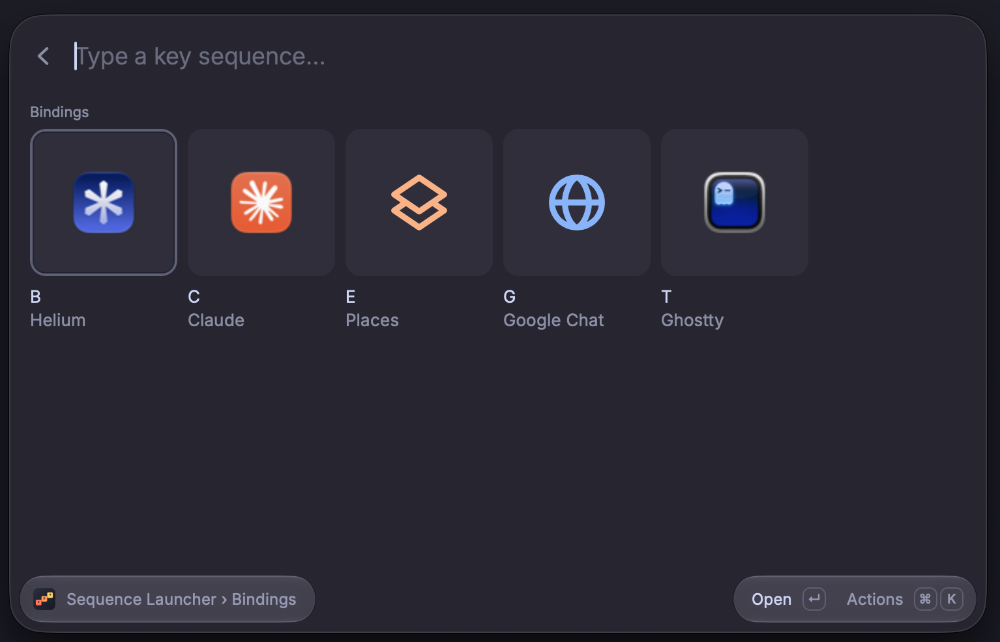
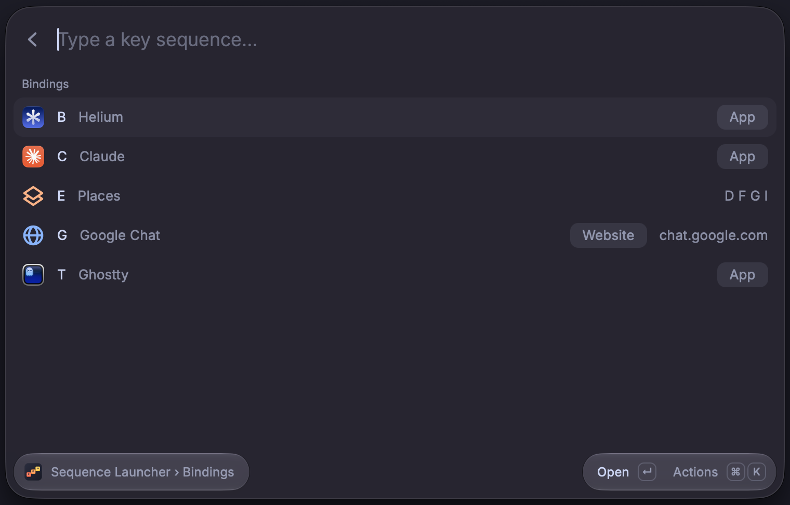

<p align="center">
  
</p>

<h1 align="center">Sequence Launcher</h1>

<p align="center"><strong>One hotkey. A few letters. Your app, folder, or link is open.</strong></p>

A Raycast extension for macOS. Press one hotkey, release it, then type a short key sequence to open an application, a folder, a website, or a link to an app. You do not press Return.

```text
Hotkey → release

S       Safari
M       Mail
E       Places
  D     Downloads
  F     Finder
T       Terminal
```

Type `E`, then `D`, to open Downloads.

A key in one group does not conflict with the same key in another group. One hotkey replaces many global shortcuts.

## Highlights

- **No Return key.** The destination opens when the last key of its sequence matches.
- **Groups.** Put related bindings under one key. A group can contain more groups.
- **Any link.** Open websites and app links such as `raycast://`, `mailto:`, or `obsidian://`. A link can open in an app that you choose.
- **Bind This.** Bind the Finder folder, the URL on the clipboard, or the front app in a few keys, without a form.
- **Search Bindings.** Find a binding by name, path, or URL, and see its keys.
- **Grid or List.** Large tiles by default, or rows with the type and path.
- **Local and private.** One JSON file that you can edit and keep with your dotfiles. No network requests, no telemetry.

## Screenshots

The Grid layout, the default:



The List layout, with the type of each binding and the keys of the Places group:



## Requirements

- macOS with [Raycast](https://www.raycast.com/)
- Node.js and npm

## Install from source

1. Clone this repository.
1. Run `npm ci`.
1. Run `npm run dev`. Raycast loads the extension as a development extension.
1. In Raycast Settings → Extensions → Sequence Launcher, record a hotkey that you do not use for something else. Example: Hyper + Space, if you use the Raycast [Hyper Key](https://manual.raycast.com/hyper-key).

The extension does not set or change hotkeys.

## Use

1. Press the hotkey and release it.
1. Type the key sequence. Letters are not case-sensitive.
1. When the sequence matches a destination, the extension opens it and closes Raycast.

A successful launch shows no message. If the destination does not open, an error message shows the reason, and Raycast stays open so that you can retry.

The screen shows only the keys that you can press next. At the start, it shows the top-level bindings. When you type the key of a group, it shows the bindings in that group. In the List layout, each row shows the key, the label, and the type: App, Folder, Website, or Link. A folder row also shows the path, and a website row shows the host. A link row shows the scheme and the host, for example `raycast://extensions`. An app row shows the application name when it is not the same as the label. A group row shows the keys in the group. A warning icon shows when the destination is not available.

The default layout is a grid of large tiles. Each tile shows the icon, the key, and the label. Hover a tile to see its type and path. To see rows with the type and path as text, set **Layout** to List in Raycast Settings → Extensions → Sequence Launcher. The keys work the same in both layouts.

You can also use the arrow keys and Return. Return on a group shows the group. Return on a destination opens it.

### Search Bindings

When you do not remember the keys, use the **Search Bindings** command. Search by label, group, path, URL, or application name. Each row shows the keys to type next time. Return opens the destination.

### Bind This

Use the **Bind This** command to add a binding without the form. Give it its own hotkey in Raycast Settings.

1. Select a folder in Finder, copy a URL, or bring an app to the front.
1. Run **Bind This**. It takes the first item that it finds, in this order: the selected Finder folder, a URL on the clipboard, the front app.
1. Type the keys for the new binding, as in the launcher. A group key enters the group.
1. When you type a free key, the binding saves at once, and a message shows, for example `Bound E G · Google Drive`.

The first row in each group shows a suggested free key. Press Return on it to bind there. If you type a key that a destination already uses, Bind This shows that destination. Press Return to replace it, or Backspace to choose another key.

## Keys

These keys work only while Sequence Launcher is open. The extension adds no global shortcut.

| Key             | Where               | Result                                                                             |
| --------------- | ------------------- | ---------------------------------------------------------------------------------- |
| Letter or digit | Launcher            | Adds the key to the sequence.                                                      |
| Backspace       | Launcher            | Removes the last key of the sequence.                                              |
| Return          | Launcher row        | Opens the destination, or shows the group.                                         |
| Return          | “No binding” screen | Resets the sequence.                                                               |
| Return          | “Could not open”    | Tries to open the destination again.                                               |
| ⌘Return         | Launcher row        | Resets the sequence.                                                               |
| ⌘K              | Launcher            | Shows all actions.                                                                 |
| ⌘N              | Launcher            | Adds a binding to the group of the selected row.                                   |
| ⌘E              | Launcher            | Edits the selected binding.                                                        |
| ⌃X              | Launcher            | Deletes the selected binding. For a group, it also deletes the items in the group. |
| ⌘R              | Launcher            | Reloads the bindings file.                                                         |
| ⌘O              | Launcher            | Opens the bindings file in the default editor for JSON.                            |
| ⌘Return         | Binding form        | Saves the binding.                                                                 |
| Return          | Search Bindings row | Opens the destination.                                                             |
| Letter or digit | Bind This           | Enters a group, or saves the binding on a free key.                                |
| Return          | Bind This           | Binds on the suggested key, or replaces the destination on a used key.             |
| Return          | Bind This row       | Shows the group, or shows the destination on that key so that you can replace it.  |
| ⌘Return         | Bind This           | Resets the sequence.                                                               |
| Escape          | Binding form        | Goes back to the launcher without a save.                                          |

Raycast assigns Return and ⌘Return to the first two actions of each row. ⌘N, ⌘E, ⌃X, ⌘R, and ⌘O are the Raycast [common shortcuts](https://developers.raycast.com/api-reference/keyboard). Escape in the launcher has the normal Raycast behavior. It does not open a destination.

**Add Binding to _group_** has no shortcut. Use it from ⌘K to add into the selected group.

## Bindings

A destination can be an application, a folder, a URL, or a group of bindings. A key is one letter (`a`–`z`) or one digit (`0`–`9`). Two bindings in one group cannot use the same key.

A URL can use any scheme that an app on your Mac opens, for example `https://`, `raycast://`, `mailto:`, or `obsidian://`. A `file://` URL is rejected: use a folder binding. A `javascript:` URL, or a URL with a user name or password, is also rejected.

A URL binding can name the app that opens it, in **Open With** in the binding form, or as `openWith` in the file. Example: open a work chat in a second browser, and keep your default browser for everything else. The row then shows the app icon and "in _app_".

If you leave the key empty when you add a binding, the form picks a free key from the label. It tries the first letter of each word, then the other letters and digits of the label, then any free key. For "Google Chat", it tries G, then C. A message shows the key that it picked.

If you leave the label empty in the binding form, the form uses the application name, the folder name, the website host, or the link scheme and host. A group gets the label "Group".

A folder path that ends in an app or bundle extension, such as `.app`, is rejected, because macOS opens the item instead of showing the folder.

## Bindings file

The bindings are in one JSON file. The default file is `bindings.json` in the extension data folder. The extension makes this file when it does not exist.

To keep the file in another place, such as your dotfiles:

1. Copy the file to the new place.
1. In Raycast Settings → Extensions → Sequence Launcher, set **Bindings File** to the new file.

You can edit the file by hand. Then use **Reload Bindings**. If the file changes on disk after the extension reads it, the editor does not save. Reload, then try again. Do not save in the editor and in a text editor at the same moment: the check and the write are two steps, so the last write wins.

See [`examples/bindings.example.json`](examples/bindings.example.json) for the format.

If the file has errors, the extension shows the first 5 errors with their locations, for example `bindings[0].children[1].key`. Sequences do not open destinations until you correct the file.

## Input behavior

- The extension reads the full text of the search field. It does not detect physical key presses.
- If you paste a full valid sequence, the extension opens the destination.
- A sequence that continues after a destination, for example `edx`, does not open anything. If you type `e`, `d`, `x` one at a time, `ed` opens before you type `x`. The `x` can then go to the destination.
- A sequence that has no binding shows **No binding for “…”**. Press Backspace to correct it, or use **Reset Sequence**.

## Privacy

The extension does not send network requests. A URL binding opens in the app that macOS assigns to its scheme. For a website, that is your default browser, and the browser then loads the page. The extension does not run shell commands and has no telemetry.

Bind This reads the Finder selection, the clipboard text, and the name of the front app one time when it starts. It keeps them only in the new binding.

In development mode (`npm run dev`), the extension writes a trace of input events to `trace.jsonl` in the extension data folder. The trace contains the typed sequences and timing, not destination paths or URLs.

## Development

```bash
npm ci
npm run typecheck
npm test
npm run lint
npm run build
```

Unit tests cover the bindings file, key matching, edits, and the rule of one launch for each sequence. Keyboard input and focus need a manual check in Raycast: see [`docs/TESTING.md`](docs/TESTING.md).

## Remove

1. Stop `npm run dev`.
1. Remove Sequence Launcher in Raycast Settings → Extensions.
1. Delete the bindings file if you do not need it.

## License

[MIT](LICENSE)
